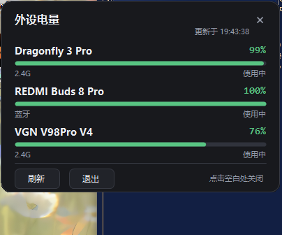

[使用教程.md](https://github.com/user-attachments/files/33767611/default.md)
# 外设电量 · 使用教程

一个常驻托盘的 Windows 小工具：**点一下就能看到鼠标、键盘、耳机的电量**，
不用再开 VGN VHUB / 罗技 G HUB 那种几百 MB 的驱动。

- 单文件 exe，**免安装、免运行库**（Windows 10/11 直接跑）
- 纯本地读取，**不联网、不上报**
- 支持：VGN 2.4G 键盘/鼠标、罗技 Lightspeed/Bolt/Unifying、蓝牙外设



---

## 一、三步开始

1. 双击 `BatteryPeek.exe`
2. 看屏幕右下角的通知区域：新图标会被 Windows 收进 **`^` 折叠区**，
   点开 `^`，把电池图标**拖到任务栏上**，以后就常驻了
3. 左键点图标 → 弹出电量面板；点面板外面关闭

> 第一次运行时如果 Windows 弹出 SmartScreen 提示，点「更多信息 → 仍要运行」。
> 这是没买代码签名证书的自编译程序都会遇到的提示。

---

## 二、面板怎么读

| 位置 | 含义 |
| --- | --- |
| 大数字 | 电量百分比，颜色随电量变化：≥50% 绿、20–49% 黄、<20% 红 |
| 横条 | 同一份电量的可视化，灰条表示"读不到" |
| 第二行左侧 | 连接方式：`2.4G` / `USB` / `蓝牙` |
| 第二行右侧 | 状态：`使用中` / `充电中` / `已充满` / `未上报` / `需厂商协议` |
| 底部 | `刷新`、`退出`；面板 60 秒自动刷新一次 |

托盘图标的枪口是**所有设备里最低的那一档**，鼠标悬停能看到每台设备的百分比。

---

## 三、常用操作

| 想做的事 | 怎么做 |
| --- | --- |
| 立刻重新读一次 | 面板里点 `刷新`，或右键图标 → `刷新` |
| 开机自动启动 | 右键图标 → 勾选 `开机启动`（写入 `HKCU\...\Run`，不需要管理员） |
| 完全退出 | 右键图标 → `退出`，或面板里点 `退出` |
| 卸载 | 退出后删掉 exe 即可；如果开过开机启动，先取消勾选 |

## 四、命令行（可选）

适合放进脚本、桌面小部件、或者在终端里瞄一眼：

```bat
BatteryPeek.exe            常驻托盘（双击时的默认行为）
BatteryPeek.exe --once     在终端打印一次，例如：
                             VGN V98Pro V4     2.4G    76%   使用中   VGN 私有协议
BatteryPeek.exe --json     以 JSON 输出，方便自己写脚本
BatteryPeek.exe --diagnose 诊断：列出 HID 集合、蓝牙设备电量属性、原始回包
BatteryPeek.exe --preview  只弹面板，6 秒后自动退出（截图用）
```

`--json` 输出示例：

```json
[
  {"name":"Dragonfly 3 Pro","transport":"2.4G","percent":99,"state":"Discharging","source":"VGN 私有协议"},
  {"name":"VGN V98Pro V4","transport":"2.4G","percent":76,"state":"Discharging","source":"VGN 私有协议"}
]
```

---

## 五、常见问题

**桌面右下角有个小的悬浮窗？**
这是**保底界面**：显示当前最低电量那一台设备和百分比。
直接点它打开完整面板，按住可以拖到任意位置，右键有「刷新 / 隐藏悬浮窗 / 退出」。
托盘图标在部分机器上会被系统或安全软件拦住，所以悬浮窗是默认开着的——
不想要就在它上面右键 → 隐藏悬浮窗，或从托盘菜单里重新打开。

**双击了没反应 / 看不到图标？**
现在的版本**每次启动都会直接弹出面板**，所以只要屏幕中央出现电量面板，就说明它在正常工作；
面板点空白处会关闭，应用继续在托盘后台跑。

图标本身的找法：点任务栏右下角的 `^`，折叠区**可能有第二页**（底部有小箭头翻页），
找到电池图标后拖到任务栏就是常驻。

如果连 `^` 里翻遍都没有，说明这台机器上图标注册被挡了（少数安全软件会拦截未签名程序注册托盘图标）。
把 exe 加进安全软件的信任区再启动即可；即使图标一直不出现，
**再次双击 exe 也会唤出面板**（新版本会把请求转给已在运行的实例，不会再"静默退出"）。

**想看日志？**
`%LOCALAPPDATA%\BatteryPeek\app.log`（若无权限则退到 `%TEMP%\BatteryPeek\app.log`）。

**某个设备显示 `—` 和「需厂商协议」？**
说明这台设备的电量走的是厂商私有协议，本工具还没实现它那套命令。
VGN 的键盘/鼠标和罗技的 HID++ 已经支持；其它品牌需要单独适配。

**VGN 键盘显示 `—` 但 VHUB 里有数字？**
键盘睡着时 dongle 会回一个空负载，工具按"读不到"处理，不会显示 0%。
按一下键盘上的键再点 `刷新` 即可。

**蓝牙耳机没有数字？**
耳机要**真的连上**（不是只配对）才会有数字。连上后 Windows 通过 HFP 配置文件
拿到耳机自己上报的电量，本工具读的就是这个值（来源列会写 `Windows PnP · HFP`）。

注意这类等级比较粗：耳机通常只上报 0–9 档，Windows 换算成百分数，
所以可能长时间停在 100% / 90%，或者切换后不立刻更新——这是耳机固件的行为。
如果显示 `未上报`，去「设置 → 蓝牙和设备」看一眼系统自己有没有显示电量：
系统都没有，任何第三方工具也拿不到。

**会被杀毒软件报吗？**
自编译的小工具可能被启发式误报。源码就在 `源码/` 里，`build.cmd` 可以自己重编。

**会不会偷数据？**
不会。全部读取都在本地完成（HID 读报告 + 系统 PnP 属性），没有任何网络代码。

---

## 六、它是怎么做到的（技术向）

三条独立的数据源，都是**只读**：

| 来源 | 用法 |
| --- | --- |
| 蓝牙 | 读 `DEVPKEY_Bluetooth_Battery`（就是 Windows「设置」里显示的那个值） |
| 罗技 HID++ 2.0 | 特征报告查 feature `0x1000`（百分比）/ `0x1001`（电压） |
| VGN 私有协议 | 见下 |

VGN 走的是 HID 私有命令通道（逆向自官方驱动，仅供学习交流）：

- **键盘**（`usagePage 0xFF60 / usage 0x61`）：63 字节帧，
  `[0]命令 [1]参数 [2]0 [3]总长 [4]包序号 [5]负载长 [6..61]负载 [62]校验和`，
  校验和 = `255 - ((reportId + 前62字节之和) % 256)`；电量命令 `0x87`
- **鼠标**（`usagePage 0xFF01 / usage 0x10`）：64 字节负载，
  `[0]=0x55 [1]=0x30`（GetBattery），回包 `[8]=电量`、`[9]=有线标志`

实现细节和踩坑记录见 `源码/docs/vgn-protocol-notes.md`。

---

## 七、开发者：自己编译 / 加新设备

```bat
cd 源码
build.cmd
```

只用系统自带的 .NET Framework 4.x 编译器（`csc.exe`），不需要 Visual Studio、不需要 NuGet。

源码结构：

```
src/SetupApi.cs        cfgmgr32 封装：枚举设备节点、读 PnP 属性
src/Hid.cs             setupapi + hid.dll 封装：枚举 HID 集合、读写报告
src/Providers.cs       三个电量来源（蓝牙 / VGN / 罗技）
src/BatteryService.cs  合并、去重、排序
src/BatteryPopup.cs    电量面板（自绘）
src/TrayApp.cs         托盘图标、菜单、刷新调度
src/Diagnose.cs        诊断输出
src/Program.cs         入口与命令行
```

加一个新品牌只要实现 `IBatteryProvider`（见 `Providers.cs`），在
`BatteryService.ReadAll()` 里注册即可；UI 和刷新逻辑完全不用改。

---

## 免责声明

非官方工具，与 VGN、罗技均无关联。读取的是各厂商未公开的 HID 私有协议，
**固件升级后可能失效**；工具只做只读查询，不会修改任何设备设置。
