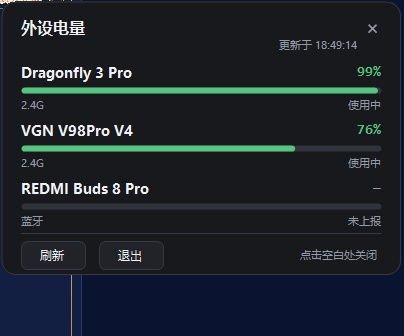

# 外设电量 / BatteryPeek

一个常驻托盘的 Windows 小工具：点一下图标就能看到鼠标、键盘、耳机的电量，
不用再打开厂商驱动。单文件 `.exe`，不需要安装任何运行时。



## 用法

双击 `dist\BatteryPeek.exe` 即可常驻托盘：

| 操作 | 效果 |
| --- | --- |
| 左键点托盘图标 | 弹出电量面板 |
| 右键点托盘图标 | 刷新 / 开机启动 / 退出 |
| 面板里的「刷新」 | 立即重新读取 |
| 点面板外任意位置 | 关闭面板 |

后台每 60 秒自动刷新一次，托盘图标显示所有设备中**最低**的那档电量，
鼠标悬停可看到每台设备的百分比。

托盘图标默认在 Windows 11 的折叠区（`^`）里，把它拖到任务栏上就是常驻显示。

## 命令行

```bat
BatteryPeek.exe            常驻托盘
BatteryPeek.exe --once     在终端打印一次
BatteryPeek.exe --json     以 JSON 输出（方便接脚本）
BatteryPeek.exe --diagnose 诊断：列出 HID 集合、蓝牙设备与 VGN 原始状态报告
BatteryPeek.exe --preview  只显示面板，6 秒后自动退出（截图用）
```

## 现在能读到什么

| 来源 | 适用设备 | 状态 |
| --- | --- | --- |
| `DEVPKEY_Bluetooth_Battery`（PnP 属性） | 蓝牙鼠标/键盘/耳机；就是「设置」里那个值 | ✅ 系统标准接口 |
| Logitech HID++ 2.0（特征报告） | 罗技 Lightspeed / Bolt / Unifying 接收器与直连鼠标 | ✅ feature `0x1000`/`0x1001` |
| VGN 2.4G（VID `0x391D`） | VGN 键盘 / 鼠标（含 2.4G 接收器） | ✅ 私有协议已打通，见下 |

面板里**不会出现编造的数字**：读不到就显示 `—`，并在状态栏说明原因
（`未上报` / `需厂商协议`）。这台机器上实测：

- `VGN V98Pro V4` — 2.4G — **76%**（和 VGN VHUB 显示一致）
- `Dragonfly 3 Pro` — 2.4G — **99%**（鼠标走另一条命令：`0x55 0x30`）
- `REDMI Buds 8 Pro` — 蓝牙 — `未上报`：经典蓝牙音频链路下 Windows 拿不到电量

面向普通用户的图文说明在 [docs/教程.md](docs/教程.md)；
打包好的分享包（程序 + 教程 + 源码）由 `release\` 生成。

## VGN 2.4G：协议（已打通）

键盘/接收器走 HID 集合 `usagePage 0xFF60 / usage 0x61`，一来一回都是 **63 字节**的帧：

```
[0] 命令        [1] 参数        [2] 0
[3] 总负载长度  [4] 包序号      [5] 本包负载长度
[6..61] 负载（最多 56 字节）
[62] 校验和 = 255 - ((reportId + 前62字节之和) % 256)
```

- **电量查询：命令 `0x87`**，无负载。回包 `[5]=负载长度(2)`、`[6]=电量%`、`[7]=充电标志`
- Windows 上这一集合只有一个合法输出报告 id **`0x09`**，所以实际写入是
  `[0x09] + 63 字节帧`（共 64 字节）；`reportId` 同时参与校验和
- 校验和算错时 dongle 不回数据，只把你发的帧原样退回并**替你补上正确校验和**——
  这个"回显"很容易被误判成"设备没数据"

实测：`09 87 00 00 00 00 02 4C 00 … 21` → 电量 `0x4C = 76%`，与 VGN VHUB 完全一致。

设备寻址（来自 VHUB 与网页驱动的配置表）：

| 设备 | VID / PID | usagePage / usage | 备注 |
| --- | --- | --- | --- |
| VGN V98Pro V4 1K 2.4G Dongle | `0x391D` / `0x2A04` | `0xFF60 / 0x61` | 命令 id `0x87`，输出报告 `0x09` |
| VGN V98Pro V4 1K（有线） | `0x391D` / `0x200C` | `0xFF60 / 0x61` | 同上 |
| VGN V87Pro V2 | `0x391D` / `0x2015`… | `0xFF60 / 0x61` | 厂商表里写 reportId `9` |
| VGN Dragonfly3 Pro（有线） | `0x391D` / `0x1003` | `0xFF01 / 0x10` | 鼠标命令集不同，未接 |

鼠标走另一套通道（`usagePage 0xFF01 / usage 0x10`）：64 字节负载 `[0]=0x55 [1]=0x30`，
回包 `[8]=电量`、`[9]=有线标志`（有线时厂商本身不给百分比）。

细节与调试记录见 [docs/vgn-protocol-notes.md](docs/vgn-protocol-notes.md)。
## 自己编译

```bat
build.cmd
```

只依赖系统自带的 .NET Framework 4.x 编译器（`csc.exe`），产物在 `dist\BatteryPeek.exe`。
源码结构：

```
src/SetupApi.cs         cfgmgr32 封装：枚举设备节点、读 PnP 属性
src/Hid.cs              setupapi + hid.dll 封装：枚举 HID 集合、读写报告
src/Providers.cs        三个电量来源
src/BatteryService.cs   合并/去重/排序
src/PeripheralBattery.cs 数据模型
src/BatteryPopup.cs     电量面板（自绘）
src/TrayApp.cs          托盘图标、菜单、刷新调度
src/Diagnose.cs         诊断输出
src/Program.cs          入口与命令行
```

## 已知限制

- 蓝牙耳机/音箱的电量依赖设备上报；只连经典蓝牙音频时多数设备不上报。
- 2.4G 只有罗技（HID++）可用；VGN 的命令帧已解出但传输层未打通，
  其它品牌（雷蛇、达尔优、VXE…）需要各自的协议，
  可以照 `Providers.cs` 里 `IBatteryProvider` 的形状继续加。
- 面板是「点开时刷新 + 60 秒后台刷新」，没有订阅设备热插拔事件。
